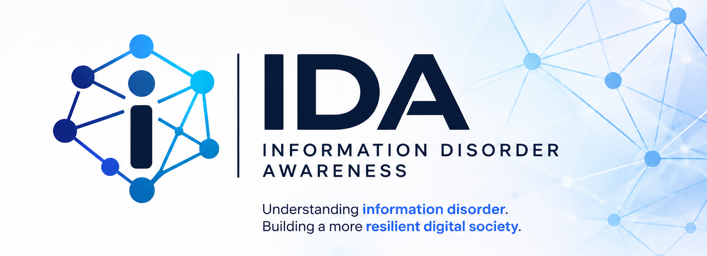

# IDA | Information Disorder Awareness

  

  Research, AI and computational methods for a healthier information ecosystem.

---

## About IDA
**Information Disorder Awareness (IDA)** is a research and technology initiative dedicated to understanding, analysing, and addressing information disorder in digital environments.

By combining artificial intelligence, data science, computational social science, and social media analysis, IDA investigates how information circulates, evolves, and influences digital societies. Its research explores technological and societal approaches to identifying misleading content, understanding coordinated manipulation, assessing information credibility, and strengthening cognitive resilience.

IDA aims to bridge scientific research and technological innovation, contributing methods, tools, and knowledge towards a more trustworthy and resilient information ecosystem.

## Research Areas

<table>
<tr>
<td width="50%" valign="top">

**🔎 Information Analysis & Integrity**

Investigating online information dynamics, narratives, information diffusion, credibility, and the mechanisms underlying information disorder.

</td>
<td width="50%" valign="top">

**🤖 Artificial Intelligence & Content Analysis**

Exploring machine learning, deep learning, and natural language processing techniques for analysing misleading, manipulated, and AI-generated content.

</td>
</tr>
<tr>
<td width="50%" valign="top">

**🌐 Social Media & Computational Social Science**

Studying online communities, information networks, coordinated behaviours, echo chambers, and influence dynamics.

</td>
<td width="50%" valign="top">

**🛡️ Cognitive Security & Digital Resilience**

Investigating information-related vulnerabilities, cognitive threats, and strategies to foster more resilient digital environments.

</td>
</tr>
</table>

## From Research to Impact

Information Disorder Awareness (IDA) originated at the University of Salerno, within the research activities of [SERICS](https://serics.eu/) (Security and Rights in CyberSpace), as part of [Spoke 2](https://serics.eu/services/spoke-2-disinformazione-e-fake-news/), focusing on Disinformation and Fake News. This research experience established the scientific foundations of IDA, fostering interdisciplinary work at the intersection of artificial intelligence, computational social science, and information security.

Building on these foundations, IDA is evolving through a new phase of research and technological development within [SINTESI](https://fondazione-fair.it/progetto-sintesi/), promoted by Fondazione FAIR, with Fondazione SERICS as co-proponent.

This evolution represents a step forward in the development of IDA's research activities, strengthening the connection between scientific knowledge, technological innovation, and real-world challenges related to disinformation and cognitive security.

## Explore Our Work

This GitHub organization brings together research projects, experimental implementations, software tools, and resources developed around the study of information disorder.

Explore our repositories to discover our work and ongoing research activities.

- **[Repositories](https://github.com/orgs/Information-Disorder-Awareness/repositories)** — Research projects, tools, and implementations.
- **[Hugging Face](https://huggingface.co/IDA-UNISA)** — Models and research resources.
- **[Publications](PUBLICATIONS.md)** — Scientific publications and research contributions.

## Publications & Scientific Contributions

IDA's research is documented through peer-reviewed journal articles, conference papers, and other scientific contributions.

For the complete bibliography, see **[PUBLICATIONS.md](PUBLICATIONS.md)**.

## Acknowledgements

IDA builds upon scientific research and collaborations established within **SERICS** and continues to evolve through new research opportunities, including **SINTESI**.

We acknowledge the contributions of the research communities, institutions, and collaborators supporting the advancement of research on information disorder.

---

  IDA · Information Disorder Awareness
   
  Research · Technology · Information Integrity · Digital Resilience

